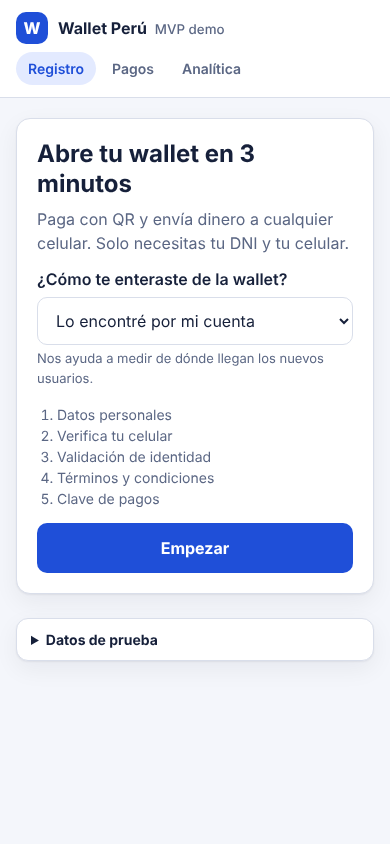
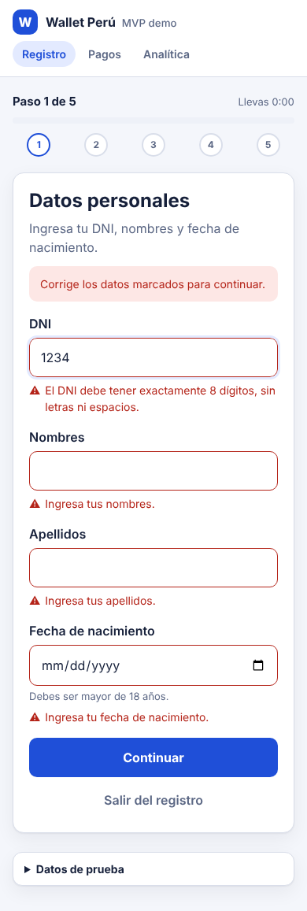
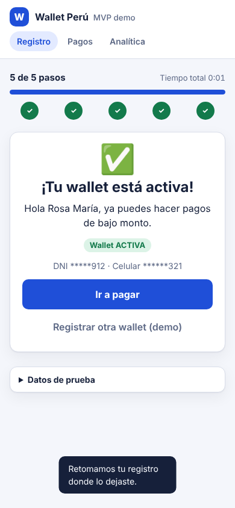
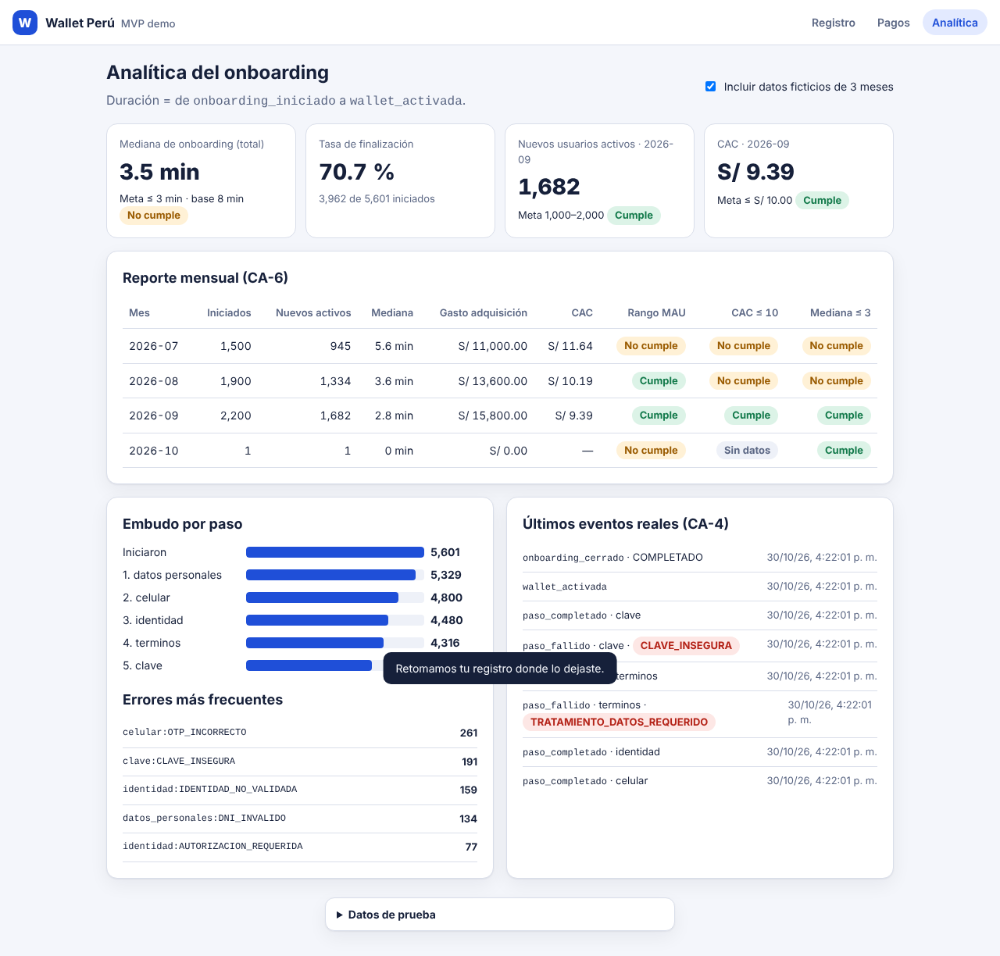

# Wallet Perú · Registro y activación (MVP)

Demo de la hackatón del Día 5. Implementa la historia de usuario **"Registro y activación del MVP de wallet"** de la épica *MVP de wallet en Perú para pagos cotidianos*:

> Como usuario de smartphone que realiza transferencias diarias de bajo monto,
> quiero completar el onboarding de la wallet con un flujo guiado y señales claras de siguiente paso,
> para poder empezar a pagar sin abandonar el proceso.

| Registro guiado | Error accionable | Wallet activa | Analítica |
|---|---|---|---|
|  |  |  |  |

> ⚠️ **Solo datos ficticios.** El OTP por SMS y la validación de identidad están simulados. No ingreses DNI ni celulares reales.

## Qué incluye

- **Onboarding en 5 pasos:** datos personales → celular con OTP → validación de identidad → términos → clave de pagos. Muestra siempre la secuencia y el paso actual (CA-1).
- **Validaciones con mensajes accionables** que bloquean el avance, campo por campo (CA-2).
- **Activación de la wallet** (`PENDIENTE → ACTIVA`) y acceso al punto de entrada de pagos. Una wallet no activa recibe `403` (CA-3).
- **Eventos analíticos** de inicio, cada paso completado o fallido, activación y cierre, sin datos personales (CA-4).
- **Analítica:** mediana de onboarding contra la meta de 3 min (CA-5), y reporte mensual de nuevos usuarios activos, gasto de adquisición, CAC y cumplimiento de metas (CA-6).
- **Retomar el registro:** si el usuario cierra la app, vuelve al paso donde quedó.
- **Datos ficticios de 3 meses** para que la analítica tenga volumen en la demo.

## Stack

| Capa | Tecnología |
|---|---|
| Backend | Python 3.12+ · FastAPI |
| Frontend | HTML + CSS + JavaScript sin frameworks ni build, servido por el mismo backend |
| Base de datos | Archivo JSON (`data/db.json`) o en memoria (`WALLET_DB_PATH=:memory:`) |
| Pruebas | pytest (52 pruebas: 45 por criterio de aceptación y 7 de las verificaciones SDD) |
| Despliegue | Docker · Render (`render.yaml`) · GitHub Actions (CI) |

## Ejecutar en local

Requiere Python 3.11 o superior.

```bash
python -m venv .venv
source .venv/bin/activate          # Windows (Git Bash): source .venv/Scripts/activate
pip install -r requirements-dev.txt
uvicorn app.main:create_app --factory --reload
```

- App: http://localhost:8000
- Documentación interactiva de la API (Swagger): http://localhost:8000/docs

### Datos de prueba

| Dato | Valor |
|---|---|
| Código SMS (OTP) | `123456` |
| DNI rechazado por la validación de identidad simulada | `99999999` |
| Cualquier otro DNI de 8 dígitos | Se aprueba |
| Celular | 9 dígitos que empiecen por 9, p. ej. `987654321` |

### Variables de entorno

| Variable | Defecto | Uso |
|---|---|---|
| `WALLET_DB_PATH` | `data/db.json` | Ruta del archivo JSON. `:memory:` para no guardar nada |
| `DEMO_SEED` | `true` | Carga 3 meses de eventos ficticios (solo en memoria) |
| `DEMO_ENDPOINTS` | `true` | Habilita `POST /api/demo/reiniciar` |

## Pruebas

```bash
python -m pytest -v
```

Cada archivo cubre un criterio de aceptación. La trazabilidad completa está en [docs/trazabilidad.md](docs/trazabilidad.md).

| Archivo | Criterio |
|---|---|
| `tests/test_ca1_pasos_visibles.py` | CA-1 · Secuencia de pasos y paso actual |
| `tests/test_ca2_validaciones.py` | CA-2 · Bloqueo y mensajes accionables |
| `tests/test_ca3_activacion.py` | CA-3 · Wallet activa y acceso a pagos |
| `tests/test_ca4_eventos.py` | CA-4 · Eventos de inicio, pasos y cierre |
| `tests/test_ca5_ca6_analitica.py` | CA-5 y CA-6 · Mediana, nuevos activos, gasto y CAC |

## API

| Método | Ruta | Descripción |
|---|---|---|
| `GET` | `/api/onboarding/pasos` | Catálogo de los 5 pasos |
| `POST` | `/api/onboardings` | Inicia un onboarding. Cuerpo opcional `{"canal_adquisicion": "redes_sociales"}` |
| `GET` | `/api/onboardings/{id}` | Estado actual (sirve para retomar) |
| `POST` | `/api/onboardings/{id}/pasos/{paso}` | Envía los datos de un paso. `422` con errores por campo si no son válidos |
| `POST` | `/api/onboardings/{id}/abandonar` | Cierra el flujo como abandonado |
| `GET` | `/api/onboardings/{id}/eventos` | Eventos analíticos de ese onboarding |
| `GET` | `/api/wallets/{wallet_id}/pagos` | Punto de entrada de pagos (`403` si la wallet no está activa) |
| `GET` | `/api/analitica/onboarding` | Embudo, tasa de finalización y mediana. Filtros `desde`, `hasta`, `incluir_demo` |
| `GET` | `/api/analitica/mensual` | Nuevos activos, gasto, CAC y cumplimiento de metas por mes |
| `POST` | `/api/analitica/gasto` | Registra gasto de adquisición `{"mes": "2026-10", "canal": "referidos", "monto_pen": 500}` |
| `GET` | `/api/analitica/eventos` | Últimos eventos registrados |
| `POST` | `/api/demo/reiniciar` | Borra los registros y recarga los datos ficticios |

Ejemplo de error (`422`):

```json
{
  "codigo": "DATOS_INVALIDOS",
  "mensaje": "Corrige los datos marcados para continuar.",
  "errores": [
    {"campo": "dni", "codigo": "DNI_INVALIDO",
     "mensaje": "El DNI debe tener exactamente 8 dígitos, sin letras ni espacios."}
  ]
}
```

## Desarrollo guiado por especificaciones (SDD)

La fuente de verdad es [`specs/001-registro-activacion/`](specs/001-registro-activacion/):

| Artefacto | Contenido |
|---|---|
| [`spec.md`](specs/001-registro-activacion/spec.md) | Criterios CA-1 a CA-6 en Gherkin, reglas RN-n, requisitos de seguridad RS-n y no funcionales RNF-n |
| [`plan.md`](specs/001-registro-activacion/plan.md) | Cómo se cumple la spec: capas, decisiones y verificación |
| [`contracts/openapi.yaml`](specs/001-registro-activacion/contracts/openapi.yaml) | Contrato de la API; cada operación cita en `x-spec` los IDs que cubre |
| [`tasks.md`](specs/001-registro-activacion/tasks.md) | Tareas enlazadas a las issues #1 a #7 |

> La spec se formalizó **después** de la primera implementación. Desde esta versión, cualquier cambio de comportamiento empieza por la spec.

Verificaciones automáticas (también corren en CI):

```bash
python tools/check_trazabilidad.py   # cada CA-n de la spec tiene pruebas
python tools/check_contrato.py       # el contrato coincide con la API real
```

La revisión por roles (Architect, Backend, Frontend, Testing, Security y Chapter) la hacen los agentes del proyecto `crew-validacion-sdd`.

## Arquitectura


Diagramas de secuencia y de estados en [docs/arquitectura.md](docs/arquitectura.md).

## Estructura

```
app/
  domain.py       Pasos, estados y validaciones (sin dependencias web)
  onboarding.py   Caso de uso: iniciar, enviar paso, abandonar, activar
  analytics.py    Mediana, embudo y reporte mensual (MAU/CAC)
  seed.py         Generador de 3 meses de datos ficticios
  store.py        Almacenamiento en archivo JSON con escritura atómica
  main.py         API FastAPI y servidor del frontend
frontend/         index.html, styles.css, app.js
tests/            Pruebas por criterio de aceptación
docs/             Supuestos, decisiones, trazabilidad y guion de la demo
```

## Despliegue

Ver [docs/despliegue.md](docs/despliegue.md). En resumen: es un único servicio (API + frontend) empaquetado con Docker.

```bash
docker build -t wallet-onboarding-mvp .
docker run --rm -p 8000:8000 wallet-onboarding-mvp
```

## Documentación del equipo

- [Arquitectura y diagramas](docs/arquitectura.md)
- [Supuestos, decisiones y limitaciones](docs/supuestos-y-decisiones.md)
- [Trazabilidad criterio → implementación → prueba](docs/trazabilidad.md)
- [Guion de la demo (5 minutos)](docs/guion-demo.md)
- [Despliegue](docs/despliegue.md)
