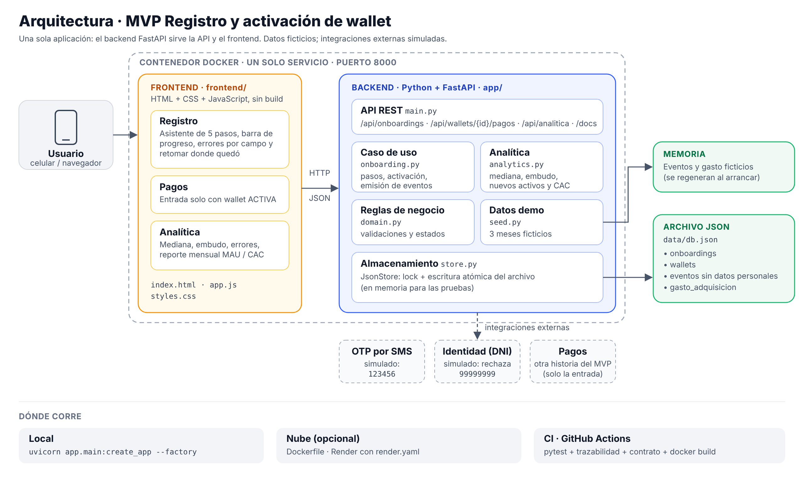
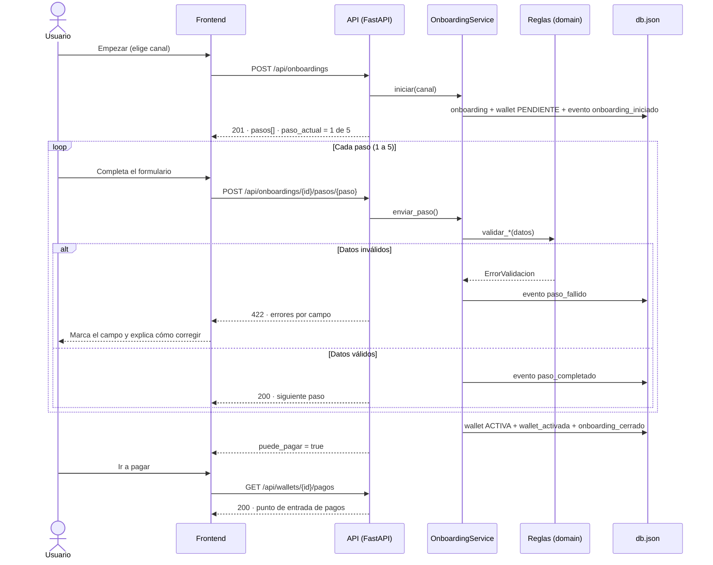
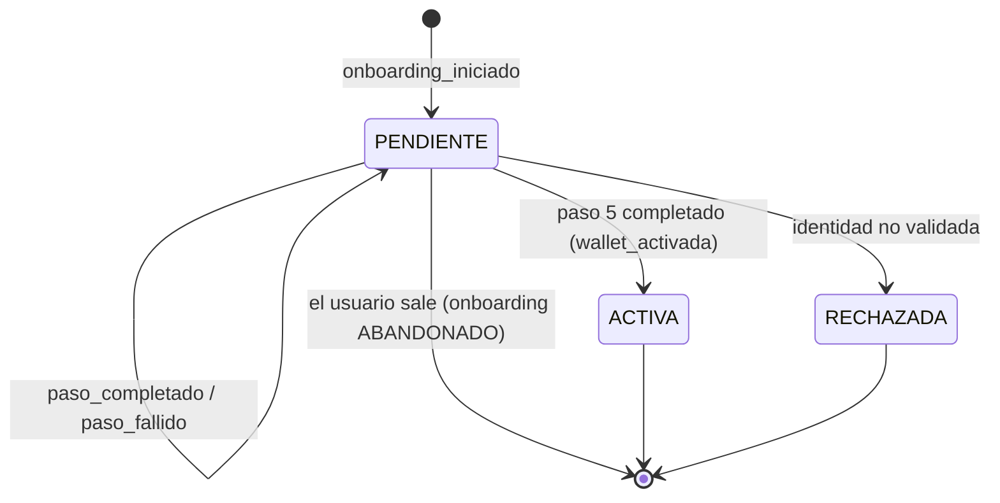

# Arquitectura

La versión editable es [`arquitectura.svg`](arquitectura.svg). El PNG sirve para las diapositivas.

## Componentes

| Componente | Archivo | Responsabilidad |
|---|---|---|
| Frontend | `frontend/` | Asistente de registro, pantalla de pagos y panel de analítica. HTML, CSS y JS sin build. |
| API REST | `app/main.py` | Rutas HTTP, traducción de errores a `422`/`409`/`403`/`404`, sirve el frontend. |
| Caso de uso | `app/onboarding.py` | Orden de pasos, activación o rechazo de la wallet, emisión de eventos. |
| Reglas de negocio | `app/domain.py` | Pasos, estados y validaciones con mensajes accionables. Sin dependencias web. |
| Analítica | `app/analytics.py` | Mediana, embudo, errores frecuentes y reporte mensual de nuevos activos y CAC. |
| Datos demo | `app/seed.py` | 3 meses de eventos y gasto ficticios, con semilla fija. |
| Almacenamiento | `app/store.py` | Archivo JSON con lock y escritura atómica; en memoria para las pruebas. |

## Flujo de registro

## Estados de la wallet y del registro

El registro tiene su propio estado: `EN_CURSO`, `COMPLETADO`, `ABANDONADO` o `RECHAZADO`. Cada cierre emite `onboarding_cerrado` con el resultado y la duración.

## De la demo a producción

Qué cambiaría para salir a producción. Esta tabla da material para la parte de "qué queda pendiente" de la presentación.

| Pieza de la demo | En producción |
|---|---|
| OTP fijo `123456` | Proveedor de SMS con expiración y límite de intentos |
| Identidad simulada | Proveedor de validación de identidad, más biometría según defina cumplimiento |
| `data/db.json` | Base de datos administrada (p. ej. PostgreSQL) con respaldo y cifrado |
| Eventos en el mismo archivo | Bus o cola de eventos hacia la plataforma de analítica |
| Sin autenticación | Sesión ligada al dispositivo, tokens y protección contra fuerza bruta |
| Gasto ingresado a mano | Integración con las fuentes de marketing (campañas, referidos) |
| Un contenedor | Varias instancias detrás de un balanceador, con monitoreo y alertas |
